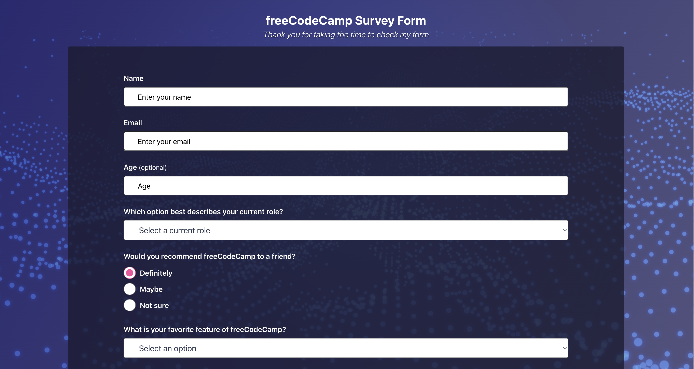

# FreeCodeCamp Survey Form

<div align="center">


</div>

## Overview

Responsive survey form built with React and Emotion as a FreeCodeCamp exercise. Demonstrates component-driven UI, theming, and accessible form controls (inputs, selects, radios, checkboxes).

## Key Features

- Responsive layout and semantic markup
- Accessible form controls with keyboard support
- Theming and global styles via Emotion

## Tech Stack

React 16, Create React App 3, JavaScript (ES6), Emotion 10

## Architecture

Single-page app scaffolded with CRA. Component-based structure (`components`, `layouts`, `ui`) with `Theme` and `GlobalStyles` for styling. No backend or API.

## Performance & Accessibility

Small SPA with static assets. Uses semantic HTML, labels, and native controls for a11y; keyboard-friendly interactions and reasonable color contrast.

## Prerequisites

- Node.js: `16.x`

## Installation

```bash
git clone https://github.com/maxgalchenko/freecodecamp__survey-form.git
cd freecodecamp__survey-form
npm install
```

## Quick Start

```bash
npm run dev
# Production
npm run build
npm start
```

Open http://localhost:3000

## Available Scripts

- `npm run dev` – Not available in CRA; use `npm start` for dev server
- `npm run build` – Create optimized production build in `build/`
- `npm test` – Run tests (watch mode via CRA; no tests included)
- `npm start` – Start local development server (CRA)
- `npm run eject` – Eject CRA configuration (one-way operation)

## Screenshots



---

<div align="center">

Built with ❤️ by [Maksym Galchenko](https://github.com/maxgalchenko)

[](https://www.linkedin.com/in/galchenko-max/)
[](https://portfolio-green-six-29.vercel.app/)
[](mailto:galchenko.maksym@gmail.com)


</div>
